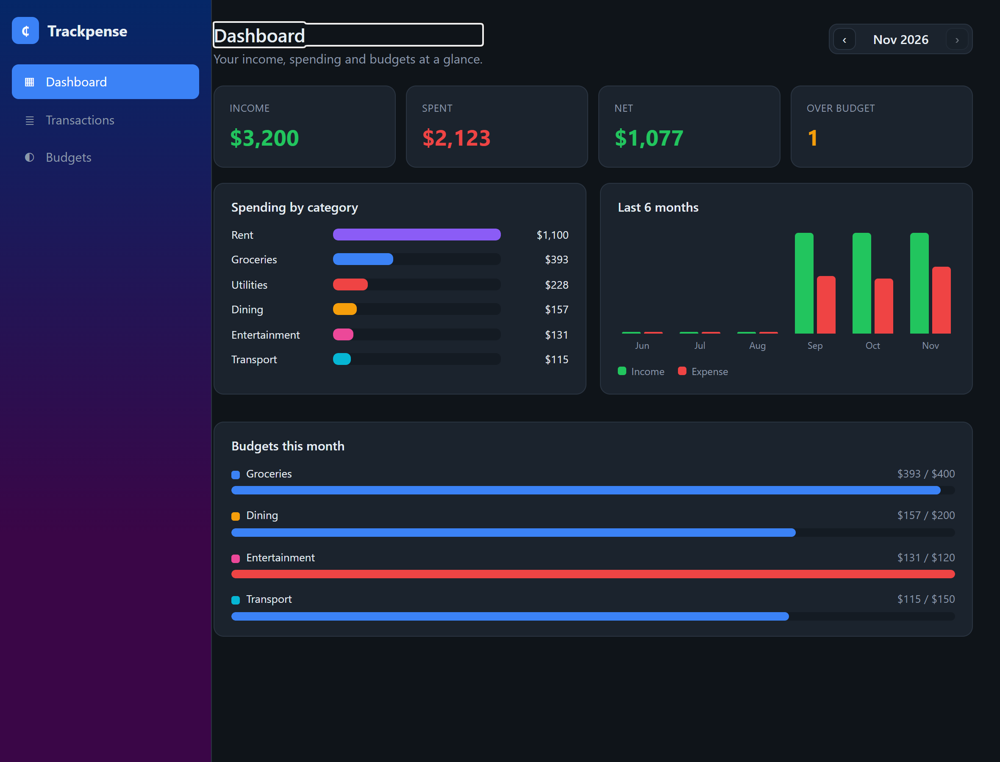
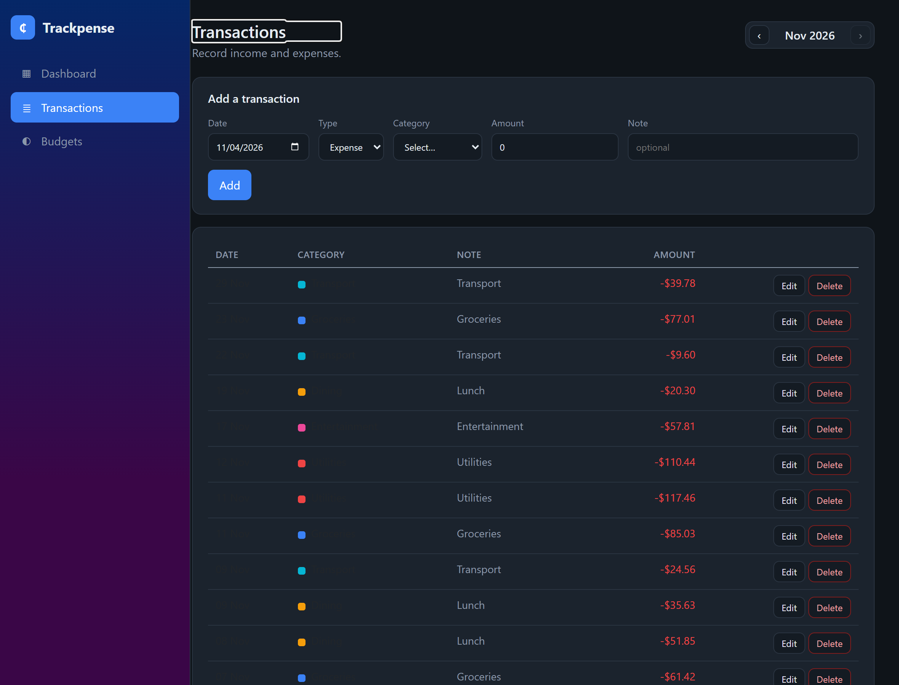

# Trackpense

[](https://github.com/BoogeyCodes/trackpense/actions/workflows/ci.yml)


A personal finance tracker built entirely in C# with **Blazor** — record income and expenses,
categorise them, set monthly budgets, and watch a live dashboard of where your money goes. Full
stack, one language.



## Why

I wanted a complete, runnable application that shows C# doing the whole job — data model, business
logic, and an interactive UI — rather than a backend with a separate JavaScript frontend. Trackpense
is that: an ASP.NET Core 8 Blazor Server app over EF Core, with the reporting logic (summaries,
budgets, trends) in a separate, unit-tested library, and charts drawn as plain inline SVG so there is
no JavaScript charting dependency. It is small enough to read and real enough to use.

## Features

- **Dashboard** with income / spending / net for the month, a spending-by-category chart, a
  six-month income-vs-expense trend, and budget progress bars that turn red when you overspend.
- **Transactions**: add, edit and delete income and expenses, each with a date, category, amount and
  note; filter by month.
- **Budgets**: set a monthly spending limit per category and track progress against it. Budgets are
  per month.
- **Month navigation** throughout, so you can review any past month.
- Seeded with a few months of demo data on first run.

## Architecture

```
  Trackpense (Blazor Server, .NET 8)
    Components/
      Pages/     Home (dashboard), Transactions, Budgets
      Shared/    MonthNav, BarChart, TrendChart  (inline-SVG charts, no JS)
      Layout/    sidebar + content
        │ inject
        ▼
  Trackpense.Core  (a plain class library, no web dependency)
    Domain/    Category, Transaction, Budget
    Data/      AppDbContext (EF Core + SQLite), DbSeeder
    Services/  TransactionService, BudgetService, SummaryService (+ MonthRef, DTOs)
        │ tested by
        ▼
  Trackpense.Tests  (xUnit, in-memory SQLite)
```

### Key decisions

- **The domain and services live in a separate library** with no Blazor or web dependency, so the
  reporting logic — monthly summaries, category spend vs budget, the trend — is unit-tested directly
  against an in-memory SQLite database.
- **A `DbContext` factory, not a scoped context.** Blazor Server keeps one DI scope for the whole
  circuit, and a shared `DbContext` across concurrent renders throws. Each service method creates a
  short-lived context from `IDbContextFactory<AppDbContext>`, the recommended pattern.
- **Charts are inline SVG/HTML**, drawn in Razor from the data, so the app has no JavaScript charting
  library and the charts render server-side like everything else.
- **Money is `decimal`**, stored positive with a direction (`Income`/`Expense`), so totals and
  budgets are exact.

## Run it

### Docker

```bash
docker build -t trackpense .
docker run --rm -p 8080:8080 -v trackpense-data:/data trackpense
# open http://localhost:8080
```

### Local

```bash
dotnet run --project src/Trackpense
# open the URL it prints (a trackpense.db SQLite file is created on first run)
```

## Testing

```bash
dotnet test
```

Eighteen tests over the core library: the summary service (income/expense/net, month boundaries,
category grouping, budget attachment and overspend flagging, the trend), the transaction service
(add/edit/delete, month and category filtering, validation) and the budget service (set, update,
clear, month scoping), each against an in-memory SQLite database. CI runs them on Linux and Windows
and smoke-tests the Docker container.

## Screens

| Dashboard | Transactions |
| --- | --- |
|  |  |

## Project layout

```
src/Trackpense         the Blazor Server app (components, pages, layout, wwwroot)
src/Trackpense.Core    domain, EF Core data layer, and services
tests/Trackpense.Tests xUnit tests against in-memory SQLite
Dockerfile · docker-compose-free single image · .github/workflows/ci.yml
```

## Ideas for later

- Multiple accounts and transfers between them.
- CSV import/export of transactions.
- Recurring transactions.
- Authentication for a multi-user deployment (it is single-user today).

## License

MIT
